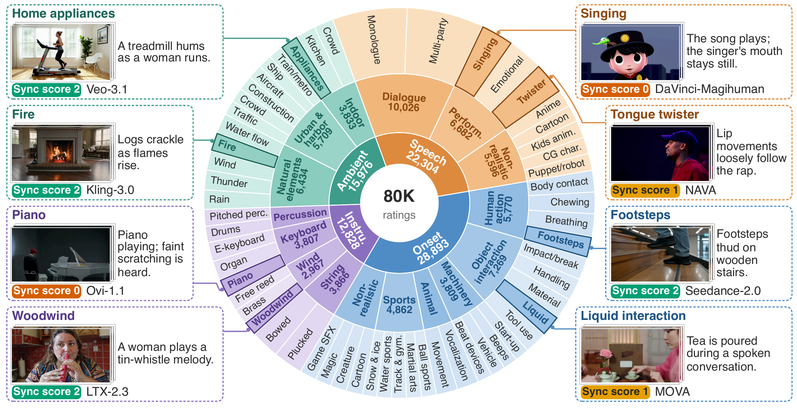
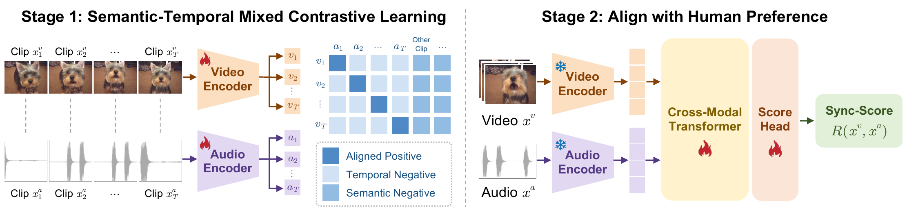
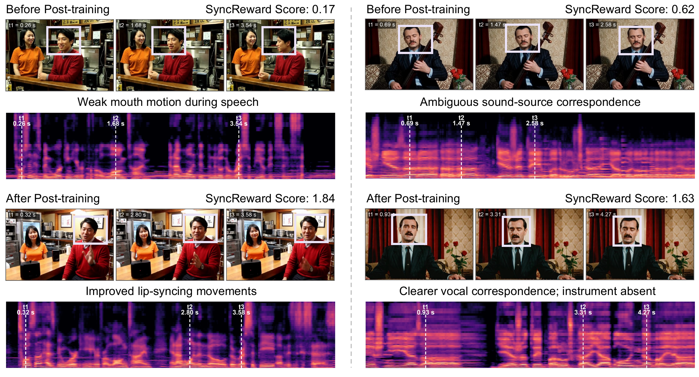
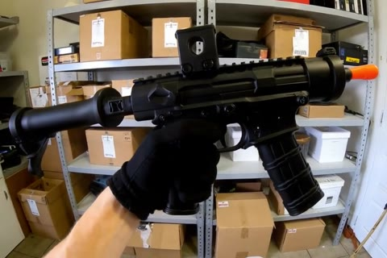
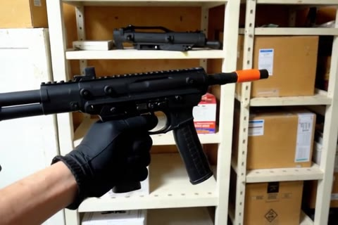
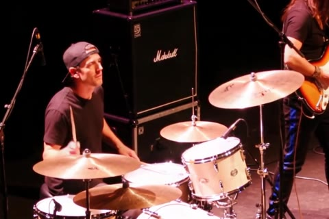
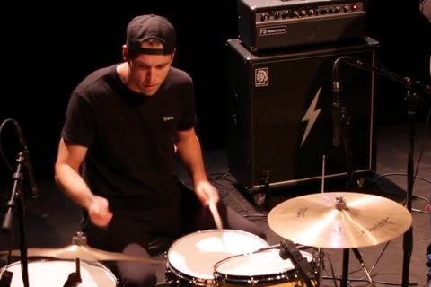
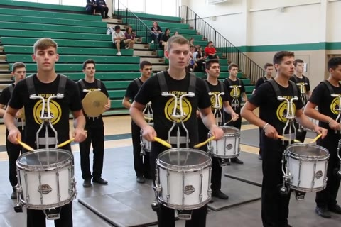
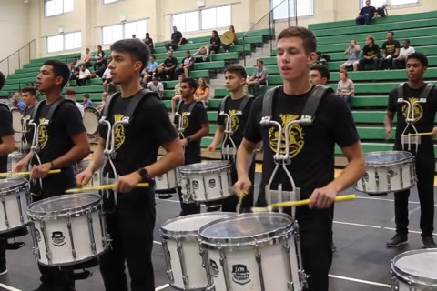

<div align="center">

# SyncReward

### Human-Aligned Synchronization Reward for Audio-Visual Generation

Kaisi Guan · Ying Ba · Wenjing Wang · Xihua Wang · Chen Li · Jing Lyu · Ruihua Song

Renmin University of China · WeChat, Tencent

[](https://huggingface.co/Guan123/SyncReward)
[](https://huggingface.co/datasets/Guan123/SyncReward-Data)
[](LICENSE)


**A human-aligned synchronization reward for videos with sound.**

[Overview](#overview) · [Showcase](#showcase) · [Quick Start](#quick-start) · [Models](#models) · [Data](#data) · [Evaluation](#evaluation) · [Training](#training)

</div>

<p align="center">
  
</p>

> **SyncReward-Data-80K at a glance.** 80K human synchronization ratings from eight audio-visual generators, organized into four sound-event families, 16 classes, and 58 fine-grained categories. Examples show visible sound sources and their human synchronization ratings.

SyncReward measures how well audible events align with visible actions, returning a **reward between 0 and 2**. It combines segment-level audio–visual contrastive learning with human preference alignment, providing a synchronization signal for evaluating generated videos and guiding post-training.

- **Temporal modeling:** a PE-AV encoder and cross-modal Transformer capture synchronization across short, overlapping audio–visual segments.
- **Human feedback:** SyncReward-Data-80K provides **80,001 ratings** over **57,099 clips** from **8 generators**.
- **Reproducible evaluation:** released checkpoints, training scripts, and a **1,000-clip benchmark** support comparison against human synchronization judgments.

---

### 🔥 News

- **[2026.10.10]** Released the SyncReward codebase with two-stage training, scoring, benchmark evaluation, and before/after video demos.
- **Paper and citation:** coming soon.

### 📝 Release Status

- [x] Video scoring and benchmark evaluation code.
- [x] Stage-1 and Stage-2 training code.
- [x] [Model checkpoints](https://huggingface.co/Guan123/SyncReward), including the full Stage-2 reward model.
- [x] [Human annotations, training splits, benchmark, and video archives](https://huggingface.co/datasets/Guan123/SyncReward-Data).
- [x] Before/after post-training demos with audio.
- [x] Apache-2.0 code license.
- [ ] Paper and BibTeX citation.

<a id="overview"></a>

### 💡 Method Overview

<p align="center">
  
</p>

> **Two-stage training.** Stage 1 learns audio-visual correspondence using aligned segment pairs, within-clip temporal negatives, and cross-clip semantic negatives. Stage 2 freezes the encoders and trains a cross-modal Transformer and score head with regression and ranking supervision to predict synchronization rewards in [0, 2].

<a id="showcase"></a>

### 🌟 Showcase

**Audio–video generation before and after SyncReward-guided DiffusionNFT post-training.**

<p align="center">
  
</p>

> **Qualitative effects of reward-guided post-training.** Video frames and corresponding log-mel spectrograms illustrate changes in synchronization. The displayed scores are SyncReward predictions. The singing example also shows a limitation: the post-trained generation omits the instrument requested in the prompt.

🔊 **Click a preview to open its 5-second video, then play with sound on.** The images below are still frames; synchronization must be judged from the original audio and video together.

| Scenario | Before post-training | After post-training |
| :--- | :---: | :---: |
| **Spoken dialogue** | [](assets/demo/case1-before.mp4)<br>[▶ Play with sound](assets/demo/case1-before.mp4) | [](assets/demo/case1-after.mp4)<br>[▶ Play with sound](assets/demo/case1-after.mp4) |
| **Singing with a string instrument** | [](assets/demo/case2-before.mp4)<br>[▶ Play with sound](assets/demo/case2-before.mp4) | [](assets/demo/case2-after.mp4)<br>[▶ Play with sound](assets/demo/case2-after.mp4) |
| **Handling a toy gun** | [](assets/demo/case3-before.mp4)<br>[▶ Play with sound](assets/demo/case3-before.mp4) | [](assets/demo/case3-after.mp4)<br>[▶ Play with sound](assets/demo/case3-after.mp4) |
| **Drummer on stage** | [](assets/demo/case4-before.mp4)<br>[▶ Play with sound](assets/demo/case4-before.mp4) | [](assets/demo/case4-after.mp4)<br>[▶ Play with sound](assets/demo/case4-after.mp4) |
| **Drumline** | [](assets/demo/case5-before.mp4)<br>[▶ Play with sound](assets/demo/case5-before.mp4) | [](assets/demo/case5-after.mp4)<br>[▶ Play with sound](assets/demo/case5-after.mp4) |

Each pair uses the **same text prompt**, but contains different generations; frames do not correspond one-to-one. In the singing example, the post-trained output omits the instrument specified in the prompt, illustrating a trade-off between synchronization and prompt fidelity. These demos illustrate a downstream use of SyncReward; this repository provides reward-model training and scoring, not the DiffusionNFT generation/post-training pipeline.

---

<a id="quick-start"></a>

### 🚀 Quick Start

#### 1. Set up the environment

The reference environment is **Python 3.12.9, CUDA 12.4, cuDNN 9.1, and FFmpeg 4.4.2**, with NVIDIA H20 GPUs. Dependency versions are pinned in [requirements.txt](requirements.txt). Install FFmpeg with shared libraries available to TorchCodec before decoding videos.

```bash
git clone https://github.com/guankaisi/SyncReward.git
cd SyncReward

conda create -n syncreward python=3.12 -y
conda activate syncreward
pip install -r requirements.txt

# Check model components and metrics on CPU; no weights or video decoding required.
python -m tests.test_smoke
```

#### 2. Download the reward model

```bash
hf download Guan123/SyncReward \
  --include "syncreward-stage2/*" \
  --local-dir checkpoints
```

**Stage 2 is all you need for scoring.** It already contains the trained Stage-1 encoder. The loader also initializes [facebook/pe-av-large](https://huggingface.co/facebook/pe-av-large), so the first run requires access to that backbone or a local copy supplied through `--encoder_path`.

#### 3. Score a video

Try the included demo clips:

```bash
mkdir -p outputs
python score.py \
  --checkpoint checkpoints/syncreward-stage2 \
  assets/demo/case1-before.mp4 assets/demo/case1-after.mp4 \
  --output outputs/demo.scores.jsonl
```

Replace the video paths with your own files to score additional clips. Each input must contain an audio track. Scores are printed to the terminal and saved as JSONL records with `video_path` and `reward` fields.

**Higher means better synchronization:** 0 represents an unsynchronized clip and 2 represents a well-synchronized clip. The score measures synchronization, not overall visual quality, audio quality, or prompt fidelity.

<details>
<summary><b>Inference settings and local backbone loading</b></summary>

The default inference window is **4.75 seconds**: 18 segments, each 0.5 seconds long, with a stride of 0.25 seconds. Center cropping is deterministic; it does not evaluate the full duration of a longer video.

| Option | Default | Purpose |
| :--- | :--- | :--- |
| `--checkpoint` | Required | Stage-2 checkpoint directory or `training_state.pt`. |
| `--encoder_path` | `facebook/pe-av-large` | Backbone identifier or local backbone directory. |
| `--crop` | `center` | Temporal crop mode; use the default for benchmark evaluation. |
| `--encode_batch_size` | `18` | Segments per encoder forward pass; lower this if GPU memory is limited. |
| `--device` | CUDA if available, otherwise CPU | Device used for inference. |
| `--output` | None | Optional JSONL output path; create its parent directory first. |

To use a local backbone:

```bash
hf download facebook/pe-av-large --local-dir checkpoints/pe-av-large
python score.py \
  --encoder_path checkpoints/pe-av-large \
  --checkpoint checkpoints/syncreward-stage2 \
  assets/demo/case1-after.mp4
```

</details>

<a id="models"></a>

### 🤗 Models

| Checkpoint | Contents | Use |
| :--- | :--- | :--- |
| [**SyncReward · Stage 2**](https://huggingface.co/Guan123/SyncReward/tree/main/syncreward-stage2) | Full reward model, including the frozen encoder; FP32 weights. | **Recommended for scoring and evaluation.** |
| [**PE-AV encoder · Stage 1**](https://huggingface.co/Guan123/SyncReward/tree/main/syncreward-stage1) | Contrastively trained audio/video towers and projection heads. | Initialize Stage-2 training. |

Each checkpoint folder includes `model.safetensors`, `config.json`, and `SHA256SUMS`. The released checkpoints are converted from the original training runs, rather than retrained for release. The model card reports that the Stage-1 checkpoint is bit-identical to the encoder embedded in Stage 2.

<a id="data"></a>

### 📊 Data

[**SyncReward-Data-80K**](https://huggingface.co/datasets/Guan123/SyncReward-Data) includes 80,001 synchronization ratings from 5 annotators over 57,099 generated clips, together with training splits and the held-out SyncReward-Bench.

| File in the dataset repository | Contents |
| :--- | :--- |
| `annotations/annotations_80k.jsonl` | Original human annotations. |
| `splits/stage2_train.jsonl` | 54,463 training clips with bias-corrected consensus targets in [0, 2]. |
| `splits/stage2_val.jsonl` | 1,636 validation clips with the same target definition. |
| `bench/syncreward_bench.jsonl` | 1,000 held-out clips; targets average up to 3 human ratings. |
| `videos/index.jsonl` | Mapping from each video path to its ZIP archive. |
| `videos/*_partNNN.zip` | Video files, unpacked under `generated/<model>/`. |

**The video archives total approximately 213 GB before extraction.** Start with metadata if you only need to inspect the data or evaluate existing predictions:

```bash
hf download Guan123/SyncReward-Data --repo-type dataset \
  --include "annotations/*" "splits/*" "bench/*" "videos/index.jsonl" \
  --local-dir data/SyncReward-Data
```

<details>
<summary><b>Download and unpack videos for model evaluation or training</b></summary>

The following downloads the complete dataset, including all video archives:

```bash
hf download Guan123/SyncReward-Data --repo-type dataset \
  --local-dir data/SyncReward-Data

(
  cd data/SyncReward-Data
  sha256sum -c SHA256SUMS
  for archive in videos/*.zip; do
    unzip -q -n "$archive"
  done
)
```

For selective downloads, use `videos/index.jsonl` to locate the archives containing the clips you need. Every manifest's `video_path` is relative to the extraction root, so use **`--video_root data/SyncReward-Data`**, not its `videos/` subdirectory.

See the [data card](https://huggingface.co/datasets/Guan123/SyncReward-Data) for annotation fields, target construction, generator coverage, and data terms.

</details>

<a id="evaluation"></a>

### 🧪 Evaluation

**SyncReward-Bench** measures agreement with human synchronization judgments on 1,000 generated clips from 7 generators. The [released model card](https://huggingface.co/Guan123/SyncReward#results) reports:

| Model | Spearman ↑ | Top-1 (N = 4) ↑ | Pairwise accuracy ↑ |
| :--- | :---: | :---: | :---: |
| Stage-1 encoder | 0.6051 | 0.6299 | 0.7455 |
| **SyncReward (Stage 2)** | **0.7823** | **0.7646** | **0.8359** |

Stage-2 95% bootstrap confidence intervals are **[0.757, 0.806]**, **[0.714, 0.819]**, and **[0.823, 0.848]**, respectively. Top-1 uses 1,000 seeded random groupings; confidence intervals use 1,000 bootstrap resamples. Pairwise accuracy compares clips with different human targets and gives half credit to prediction ties. These are reported release results, not scores produced by the quick-start demo.

After downloading and unpacking the videos, run:

```bash
torchrun --standalone --nproc_per_node=8 evaluate.py \
  --config configs/eval.yaml \
  --checkpoint checkpoints/syncreward-stage2 \
  --data data/SyncReward-Data/bench/syncreward_bench.jsonl \
  --video_root data/SyncReward-Data \
  --output outputs/eval/bench.predictions.jsonl \
  --metrics_output outputs/eval/bench.metrics.json
```

The reference evaluation uses **8 × NVIDIA H20 GPUs** and takes approximately **15 minutes**, as reported in the original release notes. For a single-GPU run, set `--nproc_per_node=1`; runtime will differ. The output includes per-clip predictions, the number of evaluated clips, headline metrics, and bootstrap confidence intervals. Check that all 1,000 clips were evaluated: missing or undecodable videos are skipped.

<details>
<summary><b>Evaluate another metric or use the launcher script</b></summary>

To compare another metric, save JSONL predictions with a numeric `reward` field and an `id` or `video_path` matching the benchmark manifest. Predictions should use a higher-is-better convention.

```bash
python evaluate.py \
  --predictions other.predictions.jsonl \
  --data data/SyncReward-Data/bench/syncreward_bench.jsonl \
  --metrics_output outputs/eval/other.metrics.json
```

This mode skips video scoring and does not require the model checkpoint or video archives. Additional outputs include Pearson correlation, Kendall's tau-b, MAE, and pairwise accuracy restricted to human target gaps greater than 0.75.

The provided launcher uses the following equivalent paths:

```bash
DATA_ROOT=data/SyncReward-Data/bench \
VIDEO_ROOT=data/SyncReward-Data \
CKPT=checkpoints/syncreward-stage2 \
bash scripts/eval_bench.sh
```

</details>

<a id="training"></a>

### 🔥 Training

SyncReward is trained in two stages:

| Stage | Data | Training objective | Trainable components |
| :--- | :--- | :--- | :--- |
| **1 · Contrastive learning** | Real audio–video clips: AudioSet, then filtered VGGSound. | Segment-level semantic–temporal contrastive learning. | PE-AV audio/video encoders and projection heads. |
| **2 · Human alignment** | Generated clips with human synchronization ratings. | Regression and pairwise ranking. | Cross-modal reward Transformer and prediction head; encoder frozen. |

**To reproduce Stage 2, start from the released Stage-1 checkpoint:**

```bash
hf download Guan123/SyncReward \
  --include "syncreward-stage1/*" \
  --local-dir checkpoints
```

The reference Stage-2 run uses **2 nodes × 8 GPUs for 1,275 steps**. Run the command below on **both nodes**, setting `NODE_RANK` to `0` and `1`, respectively, and using the same reachable node-0 address for `MASTER_ADDR`:

```bash
NNODES=2 NPROC_PER_NODE=8 NODE_RANK=0 MASTER_ADDR=NODE_0_IP \
DATA_ROOT=data/SyncReward-Data/splits \
VIDEO_ROOT=data/SyncReward-Data \
STAGE1_CKPT=checkpoints/syncreward-stage1 \
OUTPUT_DIR=outputs/stage2 \
bash scripts/train_stage2.sh --max_steps 1275
```

Replace `NODE_0_IP` with your node-0 address. Hyperparameters are defined in [configs/stage2.yaml](configs/stage2.yaml); command-line arguments override them. Retraining may produce seed-level variation rather than bit-identical weights.

<details>
<summary><b>Stage-1 training from real clips</b></summary>

Stage 1 uses **32 GPUs** in the reference recipe: first train on AudioSet, then warm-start on filtered VGGSound. Prepare a `stage1_train.txt` containing one video path per line for each phase; use absolute paths or paths relative to the repository root. The generated-video dataset above does not supply these real-video corpora or their filtering recipe.

On each of 4 nodes, run the first phase with `NODE_RANK` set to `0`, `1`, `2`, or `3`:

```bash
NNODES=4 NPROC_PER_NODE=8 NODE_RANK=0 MASTER_ADDR=NODE_0_IP \
DATA_ROOT=/path/to/audioset_manifest \
OUTPUT_DIR=outputs/stage1-audioset \
bash scripts/train_stage1.sh
```

Then initialize the VGGSound phase from the chosen AudioSet checkpoint:

```bash
NNODES=4 NPROC_PER_NODE=8 NODE_RANK=0 MASTER_ADDR=NODE_0_IP \
DATA_ROOT=/path/to/filtered_vggsound_manifest \
OUTPUT_DIR=outputs/stage1-vggsound \
bash scripts/train_stage1.sh \
  --init_from /path/to/audioset_checkpoint \
  --max_steps 5500
```

The reference release uses step 5,500 of the second phase. See [configs/stage1.yaml](configs/stage1.yaml) for training defaults. Full Stage-1 training requires substantial compute; the released encoder is the practical starting point for Stage-2 experiments.

</details>

<details>
<summary><b>Export a trained checkpoint</b></summary>

```bash
python tools/convert_checkpoint.py \
  --stage 2 \
  --input outputs/stage2/best \
  --output checkpoints/my-syncreward-stage2
```

The converter writes `model.safetensors` and `config.json`, which can be passed directly to `score.py` or `evaluate.py`. Use `--stage 1` when exporting an encoder checkpoint.

</details>

### 🗂️ Code Structure

```text
SyncReward/
├── configs/                 # Stage-1, Stage-2, and evaluation settings
├── syncreward/
│   ├── data.py              # Audio/video decoding, segmentation, and datasets
│   ├── model.py             # PE-AV encoder, reward Transformer, and checkpoint I/O
│   ├── losses.py            # Contrastive, regression, and ranking losses
│   ├── metrics.py           # Agreement metrics and bootstrap confidence intervals
│   └── utils.py             # Configuration and distributed helpers
├── score.py                 # Score videos with audio
├── evaluate.py              # Evaluate checkpoints or existing predictions
├── train_stage1.py          # Contrastive training on real clips
├── train_stage2.py          # Human alignment with a frozen encoder
├── scripts/                 # Distributed launchers
├── tools/                   # Checkpoint conversion
├── tests/                   # CPU smoke tests without pretrained weights
└── assets/
    ├── figures/             # Dataset, method, and post-training figures from the paper
    └── demo/                # Original audio–video demos and clickable previews
```

### 🤝 Acknowledgements

SyncReward builds on [Meta's Perception Encoder Audio-Visual (PE-AV)](https://huggingface.co/facebook/pe-av-large) and uses [Hugging Face Transformers](https://github.com/huggingface/transformers), [PyTorch](https://github.com/pytorch/pytorch), and [TorchCodec](https://github.com/pytorch/torchcodec). We thank their authors and contributors for making these tools available.

### ✏️ Citation

The paper and BibTeX entry are **coming soon**. In the meantime, please link to this repository when referring to the implementation.

### 📄 License

This code is released under the **Apache License 2.0**; see [LICENSE](LICENSE). The released [model weights](https://huggingface.co/Guan123/SyncReward#license) and [dataset](https://huggingface.co/datasets/Guan123/SyncReward-Data#license) are listed under Apache-2.0 in their respective cards. The PE-AV backbone is also Apache-2.0. Refer to the data card for terms applying to generated video outputs.
